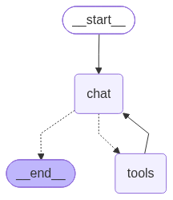

# LumenPilot Agent 架构说明

## 一次请求如何执行



```text
运营人员提问
→ FastAPI 校验会话 Token
→ 读取 LangGraph checkpoint
→ 千问判断需要调用哪些工具
→ 工具请求 LumaFeed 指标或检索运营知识
→ 工具结果写回消息状态
→ 千问生成带时间范围和来源的分析
```

## GraphState 和 PostgreSQL

`GraphState.messages` 保存用户问题、AI 工具调用和工具结果。
LangGraph 使用 `AsyncPostgresSaver` 将每一步保存到 PostgreSQL。

这样做有两个目的：

1. Agent 服务重启后仍能找到历史会话。
2. 人工确认工具触发 `interrupt` 后，可以从暂停的位置继续执行。

## 工具权限

- `query_platform_metrics`：只读，查询内容和互动指标。
- `query_merchant_risk`：只读，查询商户口碑风险。
- `search_ops_knowledge`：只读，检索运营知识并返回来源。
- `create_ops_task_draft`：写操作，必须经过 `interrupt` 人工确认。
- `ask_human`：通用澄清和确认工具。

## 消息裁剪

输出 Token 和上下文 Token 分开配置：

```text
MAX_TOKENS=2000
MAX_CONTEXT_TOKENS=12000
```

前者限制单次回答长度，后者决定工具调用链最多保留多少上下文。如果把两者混用，
多轮工具结果可能被误裁掉，导致模型看不到用户问题。

## 两条独立向量链路

运营知识 RAG 使用 `lumafeed_operations_knowledge` 表，面向社区规范、运营手册和
复盘模板；mem0 长期记忆使用独立 collection，保存用户稳定偏好。两者都基于
pgvector，但数据用途、生命周期和查询边界不同。向量库不可用时，运营知识检索
自动退回词法检索。

## 为什么用 PostgreSQL

LumaFeed 的业务数据位于 MySQL；LumenPilot 的运行状态位于 PostgreSQL。
PostgreSQL 负责 LangGraph checkpoint 和 mem0/pgvector 长期记忆，二者属于
Agent 运行时数据，不应和社区业务表混在一起。
